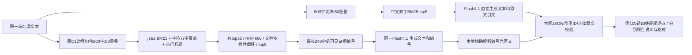

# C1-Gold100-v1：固定100题与 Simple-RAG-v1 对比

2026-10-15 完成。100次新生成、100题助手逐题评审，0重试、0付费评分、0调用错误。**综合通过39→40只是净增1题；语义全对54→40，不能据此宣称C1质量胜出。** C1改善了引用格式及本轮时延，但内容完整性退步，不替换默认版本。

## 版本身份与可比范围

- 系列 `Gold100-v1`；baseline `Simple-RAG-v1`；候选 `C1-Gold100-v1`。
- 同100题：光明50、牛黄40、独立回归夹具10；相同金标、源文本、公共校验器、评分维度与分母。所有失败保留。
- 同提供商与模型：已批准百炼 `deepseek-v4.1-flash`，thinking=false、temperature=0.2、max_tokens=800。没有第二次模型调用或修复。
- 原始C1来自2026-10-12第一轮 `candidate_pipeline.py` 与 `new_pipeline.py`，逐字复制并核验哈希。这不是后续名为 `C1_original` 的上下文打包实验。
- **这是历史C1架构在当前源快照和模型上的移植，不是历史60题运行的精确复现。** 冻结导出只有源ID和文本，标题使用原文首个非空行（最多160字）；文档分组使用源ID冒号前缀。牛黄多数记录独立分组。历史原始标题、语料组织、模型或时点与本轮不等同，不能用本轮分数改写历史44/60。
- 这是多项变化组成的架构比较，包含切块、分词、检索、提示与引用协议；不能识别单个组件的因果贡献。C1未加baseline中的当前日期说明，仍用原有两条固定无引用话术。
- 暖索引检索、提示构造、一次请求、引用解析与验证计入延迟；离线索引和评分不计。两轮不同时运行，网络/服务负载未控制。4.7秒是统计目标，不是硬取消；迟到答案仍收集计分。

## 两版本架构

C1原始额外协议检查单独记录，不替代公共评分门槛；本轮两种检查均99/100。唯一格式失败是GM-349的一个对象缺evidence字段，整包不修复、不重试。纯编号引用的好处不能抵消漏答必要条件。

## 相对baseline的结果

| 指标 | Simple-RAG-v1 | C1-Gold100-v1 | C1变化 |
|---|---:|---:|---:|
| 语义全对（四项均2） | 54/100 | 40/100 | -14题 |
| JSON/引用机械有效 | 75/100 | 99/100 | +24题 |
| 综合通过（语义且机械） | 39/100 | 40/100 | +1题 |
| 平均四维分（满分8） | 6.64 | 6.85 | +0.21 |
| 完整响应≤4.7秒 | 37/100 | 82/100 | +45题 |
| 综合通过且≤4.7秒 | 18/100 | 30/100 | +12题 |
| 平均响应 | 5.261秒 | 4.122秒 | -1.140秒 |
| p50 | 5.033秒 | 4.077秒 | -0.956秒 |
| p95（nearest rank） | 8.869秒 | 5.137秒 | -3.733秒 |
| 100题保守预算成本 | $0.524556 | $0.713176 | +$0.188620 |
| 平均每题保守预算成本 | $0.00524556 | $0.00713176 | +35.96% |

费用是共享账本的保守美元预算值：沿用把人民币数字费率按美元预留的口径，**不是实际账单或汇率换算后实付**。阶段结算后累计$123.28267945，剩余$76.71732055，0开放预留。

平均分略升但全对下降并不矛盾：不少答案事实未错，却缺一个必要条件、限定或澄清，无法达到四项全2。冻结金标严格区分必要要点与可选说明；例如GM-185即使数值及大小关系正确，未写冻结要点15亿元差额仍记完整性1。工作标注及评分可供复核；不在看到结果后放宽门槛。

| 子集 | n | baseline语义/综合 | C1语义/综合 | 平均响应baseline→C1 |
|---|---:|---:|---:|---:|
| 光明 | 50 | 28 / 14 | 20 / 20 | 4.980→4.070秒 |
| 牛黄 | 40 | 19 / 18 | 14 / 14 | 5.658→4.283秒 |
| 回归夹具 | 10 | 7 / 7 | 6 / 6 | 5.081→3.733秒 |

配对语义：12题改善、26题退步、28题双方通过、34题双方未通过。配对综合：19题改善、18题退步、21题双方通过、42题双方未通过。该固定挑战集有历史暴露，每题一条采样，不能把净增1题当统计上可靠提升或线上正确率。

## 成本与时间诊断

输入token 137410→312292；输出token 31217→11074。C1给模型更多输入证据，但让模型输出编号而非长引文，因此输出明显减少，同时输入预算成本增加。C1平均检索/构造7.462ms、生成请求4113.831ms、解析/验证0.303ms；baseline分别3.451ms、5257.773ms、0.068ms。请求耗时仍占绝大部分；没有TTFT及服务端分阶段指标，**不能把它分解为纯网络、排队、prefill或解码时间**。输出减少是时延下降的合理解释之一，不是已隔离验证的因果结论。

全部100个C1响应finish_reason=stop；baseline有2个length。C1有16题只输出固定拒答/免责声明，其中部分是合适拒答，部分是可答问题漏检索、缺澄清或必要安全回应。

## 具体改善与退步

- GM-261：找到二三层承重双方证据，正确比较1吨/平方米与350公斤/平方米；baseline没有完成对比。
- GM-398：正确把172.1 billion yuan换为1721亿元；baseline出现矛盾单位表述。
- GM-230、GM-163：流程或研发介绍完整且未因冗长抄引文而截断。
- GM-197：300万元封顶仍正确，但正文漏自用100平方米和租期3年，语义由通过变失败。
- GM-349：未检索齐签约起算和完整跨页流程，并缺协议字段；baseline通过，本轮失败。
- GM-219：将投资退出条款与经营团队奖励条款拼接，误写金额和“且”条件；格式正确仍是内容失败。
- NH-AMB-01：把检索到1条牛黄丸说成全集合共1首；不是全库统计。NH-HOP-02/04同样用书籍概述代替数据集计数。
- 澄清/边界：部分原本可答的普通介绍、别名、未来信息和个人医疗问题被同一句拒答覆盖，缺少按问题所需的具体说明。FAQ-03虽然归属材料主张，但未明确材料不能证明所有人安全。

保留baseline作为比较锚点；本轮不宣称整体质量优于baseline、不进行生产替换。下一轮建议只移植证据编号到baseline，其余检索和提示语义保持相同，验证能否保留54题语义质量同时减少机械失败；必须仍跑完整100题。这是建议，尚未执行或计费。

## 复现、保存与限制

私有版本目录为 `gold100-c1-v1-20261015`；基线目录为 `gold100-v1-20261015`。`freeze.json`固定代码/配置/问题/源文本/请求哈希；`provenance.json`保存历史模块哈希和依赖版本；`answers`保存100原始响应、解析结果、调用日志及预算账本；`manual_review.tsv`与`reviews.json`保存四维评分和理由；`paired-results.json`/`comparison.json`与`comparison.html`保存全部100题配对。中央 `gold100-experiment-registry.json`给每版记录架构、指标及相对baseline差值。

四个离线检查通过；两轮冻结文件未改；100个唯一题号与评审一一对应；公共校验结果重算一致；100开始/100终结、0重试；账本已核对；HTML包含100个配对且文本转义。未做浏览器渲染检查。源材料和标签未经过独立专家/影印全量审校，可能存在OCR和目录问题。本轮是助手按冻结源证据评审，不称独立人工金标或盲审。原始资料与详细答案保持本地私有。

## 实际使用致谢

本轮直接复用本项目历史C1检索、提示、段落分割和编号解析代码，新增适配与评测脚本；没有新安装或复制外部论文代码。使用既有jieba0.42.1（MIT）与numpy2.0.2，保留既有许可证和README致谢。RRF与BM25是经典方法，不声称近期论文创新或新的论文复现。
